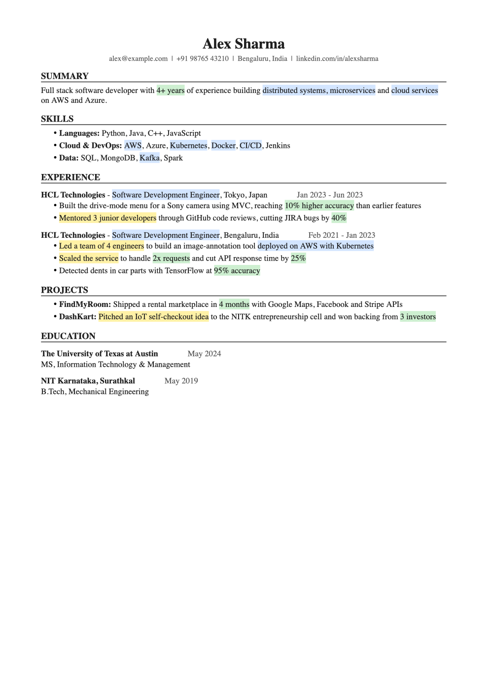

# Tailor Resume — a Claude skill

Turn your resume into a **job-specific, ATS-friendly Word resume** in about 2 minutes, with colour highlights recruiters can skim:

| Colour | Means |
|---|---|
| 🟨 Yellow | **Behaviour you proved**: leadership, ownership, initiative shown as actions |
| 🟩 Green | **Achievements in numbers**: %, counts, time, money |
| 🟦 Blue | **The job's language**: the exact skills and phrases from the job description |



## What it does

1. Reads your resume **once** (PDF, Word or screenshots) and remembers it.
2. Takes the job description as a **link, screenshots or a PDF**. If a link is behind a login, it asks for screenshots.
3. Asks two quick questions: **which highlights** you want (any or all three) and **one page or two** (it recommends one).
4. Rewrites and reorders your bullets for that job, without inventing anything, and builds a clean single-column `.docx`.
5. Shows a preview, the job keywords covered, and any gaps. Ask for changes or say **open**.
6. Opens Google Drive so you can open it in **Google Docs**, edit, and download.

Files are saved in `~/Documents/Tailored Resumes/`.

## Install

You need [Claude Code](https://claude.com/claude-code) (terminal or desktop app) and Python 3.

```bash
git clone https://github.com/ritu-dadhwal4/tailor-resume-skill.git
```

```bash
mkdir -p ~/.claude/skills && cp -r tailor-resume-skill/tailor-resume ~/.claude/skills/
```

```bash
python3 -m pip install --user python-docx
```

## Use

In Claude Code, type:

```
/tailor-resume
```

and attach your resume plus the job link, screenshots or PDF. Next time, just send the job description.

## Why the highlights stay light

At most two short highlighted phrases per bullet, and some bullets stay plain, so the page is easy to skim instead of looking busy. There is no legend on the page by default. Ask for one if you want it.

## ATS-friendly by design

One column, standard headings, real text (no tables, icons, photos or text boxes), contact details in the body (not the page header), Calibri font.

## License

MIT
